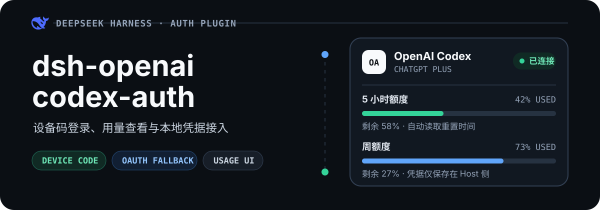
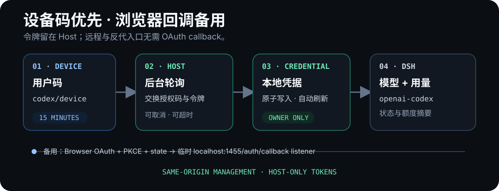

<p align="center">
  
</p>

<p align="center">
  <strong>把 ChatGPT 订阅的 Native Codex Provider 接入 DeepSeek Harness。</strong><br>
  设备码优先、浏览器 OAuth 备用；默认注册 <code>openai-codex</code>，在 DSH 设置页完成登录、查看用量并直接运行 Codex Responses。
</p>

<p align="center">
  <a href="#快速开始">快速开始</a> ·
  <a href="#两种登录方式">登录方式</a> ·
  <a href="#功能一览">功能一览</a> ·
  <a href="#远程与反向代理">远程访问</a> ·
  <a href="#凭据处理边界">安全边界</a>
</p>

## 快速开始

版本 `0.13.0` 明确适配 DeepSeek Harness `0.2.0-rc.2`，SDK peers/runtime helpers 精确锁定该版本；不声明兼容旧 SDK。旧 DSH `0.1.5-rc.1` profile 应保留原插件 `0.11.2`，升级时在独立 profile 安装新版插件并保留原 profile/锁文件以便回滚。无需迁移账号文件或浏览器隐藏列表；`dsh.engines` 仅作兼容性说明，不当作宿主硬门禁。

回归范围包含真实目标 LLM/tools 服务、本地 HTTP/SSE/WebSocket 回放、错误/取消，以及模型隐藏在真实目录/catalog/store 的投影更新、重连和重新加载。验证命令为 `pnpm typecheck && pnpm build && pnpm test`；0.13.0 候选版已通过目标版本构建、类型检查和 517 项测试；当前未执行线上 OAuth/付费模型验收。

`0.11.0` 移除了插件额外设置的请求、响应、SSE/WebSocket、图片和重放状态大小上限，以及相应的 transport 选项（含 `maxRequestBodyBytes`）；旧配置中的该字段应删除。搜索结果完整保留，WebSocket 继续优先复用增量上下文。服务端限制、协议校验及 DSH 文件/附件策略仍生效。

将插件安装到 DSH 的 `web` profile：

```sh
dsh plugin --profile web add @pure01fx/dsh-openai-codex-auth
```

Native Adapter 默认持有 `openai-codex`。如果现有整合包仍把该 route 配给 `llm-pi-ai` 或其他 Adapter，应由整合包先释放该 route；不要同时挂载两个 owner。只需要本插件的 OAuth/UI 时可显式设置 `nativeAdapter: false`。

开发 checkout 也可直接使用本地路径：

```sh
dsh plugin --profile web add /absolute/path/to/dsh-openai-codex-auth
```

启动或重启 Web profile：

```sh
dsh web
```

然后：

1. 打开 DSH Web，进入 **设置 → OpenAI Codex**。
2. 点击 **使用设备码登录**。
3. 先复制设置页显示的用户码，再点击按钮打开 OpenAI 验证页并完成登录。
4. 返回 DSH，在 **设置 → 模型提供方** 中选择 `openai-codex`。

设备码登录无需 OAuth callback，适合本机、SSH 隧道和 HTTPS 反向代理场景。

## 云端搜索和图片工具

插件通过当前 Codex OAuth 账号提供以下普通 DSH 工具，支持 native 和 Code Mode。无需切换专用 preset；需要该 preset 已提供公开的 tools 服务。服务端是否开放能力仍取决于账号和模型。

| 工具 | 用途 | 关键参数 |
| --- | --- | --- |
| `codex_web` | 网页/图片搜索、打开、点击、查找、PDF 截图、金融、天气、体育和时间 | `commands` 必填；`model/context/mode/search_context_size/user_location/filters/image_settings` 可选 |
| `codex_image_generate` | 文生图，保存每张原图及预览附件 | `prompt` 必填；`model/quality/background/size/n` 可选 |
| `codex_image_edit` | 编辑 1–5 张图片 | `prompt` 必填；`images` 或 `num_last_images_to_include` 二选一；其他参数同生成 |
| `codex_image_inspect` | OCR、截图/图表解释及普通识图 | `prompt/images` 必填；`model/detail/reasoning_effort` 可选 |

```yaml
cloudTools:
  enabled: true
  search: true
  imageGeneration: true
  imageEditing: true
  imageInspection: true
  # searchModel: <你的 Codex 目录中的模型 ID>
  # visionModel: <你的 Codex 目录中支持图片的模型 ID>
  imageModel: gpt-image-2
  searchMode: live           # cached | indexed | live
  visionDetail: auto        # auto | low | high | original
```

搜索和识图依次选择显式 `model`、对应配置、当前 Codex 模型。使用 DeepSeek 等其他模型作为主模型时，需要明确配置 Codex 的 searchModel/visionModel；不会把主模型的名称发给 Codex。生成和编辑默认使用 gpt-image-2，与主模型无关。只需 OAuth/Provider 时可设置 `cloudTools.enabled: false`；缺失工具服务不会影响登录与文本模型。

调用示例（Code Mode 的 `tools.*` 接口）：

```ts
const found = await tools.codex_web({
  commands: { search_query: [{ q: 'OpenAI Codex documentation' }], response_length: 'short' },
})
console.log(found)
// 后续 open/click/find 使用搜索结果中的 ref_id；也可以 open 一个 URL。

const created = await tools.codex_image_generate({
  prompt: 'A simple red circle on a white background', size: '1024x1024', n: 1,
})
console.log(created)
// 下一次调用可指定原图 path，或 images:[{attachment_id:附件ID}]。
const edited = await tools.codex_image_edit({
  prompt: 'Change the circle to blue', num_last_images_to_include: 1,
})
console.log(edited)
```

搜索的 commands 支持 `search_query/image_query/open/click/find/screenshot/finance/weather/sports/time`，至少提供一个非空操作数组；response_length 不能单独调用。搜索默认只发送最近两条用户文本及其间最多 1000 UTF-8 字节的 assistant 文本（保守小于等于 token 上限），显式 context 可覆盖；不会发送系统提示、隐藏推理或工具私有上下文。引用按账号和会话隔离，切换账号后请重新搜索。结果保留正文、来源 URL、有界 opaque results 和引用；截断会明确注明。

可识别的内联图片结果进入 DSH 附件。当前公开 web 服务只返回 HTML/文本，远程图片/PDF 截图 URL 会保留为链接并注明无法提取图片；不会把 OAuth 发往这些 URL。未知图片结构保留为有界结果，不能把链接展示当成图片已下载。主模型不支持图片时保留附件元数据与文字，不向该模型发送 image block。

图片工具需要调用者的 fs、attachments 服务；生成/编辑的原图保存还需要执行文件权限的 shell 和 sandboxPolicy。原图写入调用者工作区的 `.dsh/codex-images/`，采用独占创建、0600 权限并返回可读路径。预览可能经过缩放、转码或 EXIF 旋转，原图与预览尺寸分别记录。附件 ID 必须来自当前可见会话或本次程序已返回的图片；绝对路径按调用者文件权限读取。编辑默认不是 multipart，不支持未声明的 mask/seed 字段。

生成/编辑默认 quality、background、size 均为 auto，n 缺省不发送；一次最多返回 4 张图，输入最多 5 张，聚合图片字节有上限。服务拒绝、不确定网络失败或本地保存失败不会触发自动重复生成。401 仅允许同账号刷新后重试一次；不自动切换账号。

识图是额外的一次无工具 Responses/Responses Lite 调用，返回文本、用量及实际发送图片尺寸。支持 original 的普通模型会保留原文件编码数据；不支持时降为 high，Lite 省略 detail。只提供缩放附件不能恢复原始像素。普通会话附图依旧直接发给主模型，不会隐式加一次识图调用。实时语音不在此实现范围内。

详细源码依据、验证状态和限制见 [CODEX-COMPATIBILITY.md](./CODEX-COMPATIBILITY.md)。

## 多账号切换

- 已登录后继续点击 **用设备码添加账号** 或 **用浏览器添加账号**，可追加 ChatGPT 账号；新登录的账号会自动成为当前账号。
- 设置页的 **已添加账号** 列表支持设为当前和单独移除。切换是全局的，只影响切换完成后的新 Codex 请求；已开始的请求继续使用启动时绑定的账号。
- 移除当前账号时，插件按账号列表顺序选择下一个账号；移除最后一个账号后会清除 `DSH_OPENAI_CODEX_TOKEN`。
- 原有单账号 `version: 1` 凭据会在首次读取时原子迁移为 `version: 2` 多账号文档，无需重新登录。
- 如果 `DSH_OPENAI_CODEX_TOKEN` 来自只读环境变量或其他外部 authority，插件会拒绝需要改写当前 token 的登录、切换和退出操作，避免界面与实际请求账号不一致。

## 两种登录方式

### 设备码登录（推荐）

1. Host 从 OpenAI 申请一次性用户码。
2. 设置页显示用户码、验证网址和 15 分钟倒计时。
3. 用户可以在任意设备打开 <https://auth.openai.com/codex/device> 并输入代码。
4. Host 后台轮询授权结果，交换令牌并写入本地凭据。

设备码 flow 的临时 ID、用户码和轮询状态只存在于内存；DSH Web 重启或用户取消后即失效。

> [!NOTE]
> OpenAI workspace 可能要求管理员允许设备码登录。若申请接口返回 404，设置页会提示改用本机浏览器 OAuth。

### 本机浏览器 OAuth（备用）

OpenAI 的 Codex 公共 client ID 只接受已注册的精确 callback：

```text
http://localhost:1455/auth/callback
```

点击浏览器登录后，设置页会展开诊断卡片，插件同时在 IPv4/IPv6 loopback（`127.0.0.1`/`::1`）的 1455 端口启动临时 callback listener。浏览器会探测自身到 `127.0.0.1:1455` 的连接：成功显示绿色勾选；失败则给出端口转发提示，并提供重新检测和强制继续按钮。外部 OpenAI 页面只会在用户点击按钮后打开。

如果自动 callback 无法抵达，还可以把浏览器地址栏中的完整 callback URL 或 authorization code 粘贴回诊断卡片完成交换。登录完成、取消、失败或 10 分钟超时后 listener 立即关闭；1455 不会在 DSH 启动后常驻监听。

只有通过 HTTP `127.0.0.1` 或 `localhost` 打开 DSH 时，设置页才启用浏览器 OAuth 按钮。反代域名、LAN IP 或 HTTPS 入口应使用设备码。若 DSH 运行在远程服务器，还必须把本机 1455 转发到服务器的 1455。

## 功能一览

| 能力 | 说明 |
| --- | --- |
| 设备码登录 | 无本机 callback，支持远程/headless 使用 |
| 浏览器 OAuth fallback | PKCE + state、端到端 1455 探测、手动 code 回填和临时 callback listener |
| 多账号管理 | 添加多个 OAuth 账号、全局切换当前账号、单独移除，并自动迁移旧单账号凭据 |
| Codex 用量面板 | 展示短周期与周用量、剩余额度和重置时间；Native 模式直接接收 Codex 返回的套餐额度，`wham/usage` 仅作初始读取和 fallback |
| 当前路由状态 | 设置页显示 `openai-codex` 当前由本插件 Native Adapter、外部 Adapter 或无人持有；Native 模式同时显示 WebSocket v2 或 HTTP/SSE |
| 输入框额度圈 | 登录后显示在输入框右下角；悬停或键盘聚焦显示用量，点击圆圈强制刷新，不做常驻额度轮询 |
| 模型列表隐藏 | 在 Codex 设置页勾选不想看到的模型；只保存在当前浏览器并立即过滤模型选择器，不影响已有会话或 Host 路由 |
| 自动凭据续期 | 在令牌接近过期时刷新，并更新 DSH credentials |
| DSH 模型接入 | 将有效令牌提供给 `openai-codex` 模型提供方 |
| 登录生命周期管理 | 支持取消、15 分钟设备码超时、10 分钟浏览器超时和安全退出 |
| 同源管理路由 | 状态与控制接口挂载到 DSH Web；1456 已移除，1455 仅在浏览器登录期间临时使用 |

## 工作方式

<p align="center">
  
</p>

登录成功后：

1. 多账号凭据以 owner-only 权限原子写入 `$DSH_HOME/openai-codex-auth.json`；文档保存账号列表与全局当前账号指针。
2. 当前账号的 access token 通过 DSH credentials 注入 `DSH_OPENAI_CODEX_TOKEN`。
3. `openai-codex` 模型提供方在每个请求开始时读取当前凭据，并把该次尝试固定到同一个账号。
4. 输入框右下角显示 Codex 额度圈；悬停或键盘聚焦显示当前用量，点击才强制刷新。Native transport 优先消费 WebSocket `codex.rate_limits` 事件或 HTTP `x-codex-*` headers，未收到直接更新时才在 turn 结束后读取 `wham/usage`。
5. 设置页与额度圈只读取登录状态、账号 ID、过期时间和用量摘要，不接触 token。

## 同源路由

日常状态与控制接口由 DSH Web 提供；只有浏览器 OAuth flow 会额外创建一个短生命周期 callback Server：

| 方法 | 路径 | 用途 |
| --- | --- | --- |
| GET | `/openai-codex/status` | 登录、账号列表、当前账号、flow、用量和 CSRF 状态 |
| POST | `/openai-codex/accounts/current` | 以 `{ "accountId": "…" }` 设定全局当前账号 |
| POST | `/openai-codex/accounts/logout` | 以 `{ "accountId": "…" }` 单独移除账号 |
| POST | `/openai-codex/device/start` | 创建或复用设备码 flow |
| POST | `/openai-codex/browser/prepare` | 创建浏览器 flow，返回授权 URL 和一次性 1455 探测 URL |
| POST | `/openai-codex/browser/complete` | 接收用户粘贴的 callback URL 或 authorization code |
| GET | `/openai-codex/browser/start` | 兼容入口：直接启动并跳转浏览器 OAuth |
| POST | `/openai-codex/cancel` | 取消当前登录、关闭临时 listener，保留旧凭据 |
| POST | `/openai-codex/logout` | 兼容入口：取消 flow 并移除当前账号 |

1456 已完全退役。1455 平时关闭，仅浏览器 OAuth pending 时绑定 loopback；设备码登录完全不使用它。

## 远程与反向代理

### SSH 隧道

设备码登录只需转发 DSH Web 端口，本地端口可以不同：

```sh
ssh -L 8080:127.0.0.1:3080 user@server
```

若还要使用浏览器 OAuth fallback，同时转发 OpenAI 固定的 callback 端口：

```sh
ssh -L 8080:127.0.0.1:3080 -L 1455:127.0.0.1:1455 user@server
```

然后打开 `http://localhost:8080`。设备码登录仍不依赖 1455；只有浏览器 fallback 会临时使用该转发。

### HTTPS 反向代理

DSH Web 继续绑定 `127.0.0.1`。为外部域名配置 DSH trusted host：

```sh
dsh web --trusted-host dsh.example.com
```

反代必须保留浏览器原始 Host，例如 Nginx：

```nginx
location / {
    proxy_pass http://127.0.0.1:3080;
    proxy_set_header Host $http_host;
    proxy_set_header X-Forwarded-Proto $scheme;
}
```

通过反代域名访问时使用设备码登录；浏览器 OAuth 按钮会被禁用。反代还需按 DSH Web 本身的要求转发 WebSocket。

## 配置

插件通常无需额外配置。默认凭据文件为：

```text
$DSH_HOME/openai-codex-auth.json
```

如需改变存储位置，可在 Cordis 配置中设置 `path`：

```yaml
- insert:
    - id: openai-codex-auth
      name: '@pure01fx/dsh-openai-codex-auth'
      config:
        path: /secure/path/openai-codex-auth.json
```

`path` 的优先级高于 `dshHome`。

### 原生 Codex transport 与组合边界

本包跟踪的上游 Codex repository、commit、release 与 Catalog client version 只在 `src/upstream.ts` 维护；升级上游时先更新该文件，再刷新 fixtures、生成产物和兼容测试，避免多个散落 hash 漂移。

从 0.6 开始，Native Adapter 是插件默认 Provider，并持有生产 route `openai-codex`。旧预览会话确实需要时，可显式设置 `nativeCompatibilityRoute: true`，让同一个 adapter 同时注册 `openai-codex-native` 兼容 route；启用兼容 route 时两者仍原子注册，任一 route 已被占用都会整体失败。默认只暴露生产 route。

本包只定义 Codex Provider，不发布或改写任何具体 Profile。整合包必须在挂载本插件前释放已有的 `openai-codex` route，例如从自己的 `llm-pi-ai` provider map 中移除该项；本包不会清空未知的 sibling providers。只想复用 OAuth/UI 并继续使用外部 Provider 的组合可以显式设置 `nativeAdapter: false`。从 pi-ai 切到 Native 时，旧 foreign replay 会降级为可见持久历史；反向切回 pi-ai 后，已产生 Native replay 的进行中 session 不保证可续跑，应新建 session。

上游 Native Codex Responses 请求没有输出 token 上限字段，因此普通会话若显式设置 `maxTokens` 仍会在 Provider I/O 前失败。DSH 的压缩与会话标题辅助调用会固定携带 `maxTokens`，并分别通过 `purpose: compaction` 与 `purpose: session-title` 标识；本适配器允许这两类 hint 通过，但不会把它序列化为 `max_output_tokens`，实际输出长度仍由 Native Codex 决定。

原生 route 默认使用 Responses WebSocket v2，在会话首个请求上执行 `generate: false` prewarm，并仅在请求历史严格延伸时发送 `previous_response_id` 与增量后缀。连接重建会清除增量链；凭据解析完成前的网络失败不消耗普通 stream retry 预算，而是按 Codex 的网络恢复策略从 5 秒指数退避到 60 秒并持续等待成功或取消。凭据可用后，WebSocket 连接建立失败与连接已经建立后的首个 DSH chunk 前错误都使用默认 5 次 stream retry 与 200ms 起步的有界指数退避；安全重试耗尽或握手返回 HTTP 426 后，该 DSH 会话会确定性地回退到 HTTP/SSE，因此仅 WebSocket 不可达不会让界面无限停在 Deep diving。transport 层在任何 DSH chunk 已输出后仍不会直接重放原始 stream；它会把瞬态中断重新分类为只允许 durable failed-step 恢复的错误，标准 Agent Profile 中的 `dsh-llm-retry` 再按默认 5 次策略重建请求。该外层策略不会再次匹配 transport 已在首个 chunk 前耗尽的有限 stream 错误，避免两层预算相乘；失败 attempt 的原始事件可以留作非 surface 诊断，但不会组装成模型可见的持久 assistant message。未加载该恢复插件的直接 `ctx.llm.stream()` 调用在首个 chunk 后仍保持 single-attempt，避免重复输出。WebSocket `codex.rate_limits` 事件、握手/错误 metadata 以及 HTTP/SSE response headers 中的 `x-codex-*` quota 会被边界校验后直接写入 Host 用量缓存；额外 metered limit 不会覆盖默认 `codex` 套餐卡片。`response.completed.usage_metadata.amount` 会按原始高精度字符串保留，并作为当前账号的最近响应观测出现在 status JSON 中。

`<base>-fast` 只是公开选择别名：wire model 仍是 `<base>`，请求携带 `service_tier: priority`。若账号目录不声明 priority 能力，或请求前账号 authority 已改变，Fast 会直接失败，不会静默降级。Reasoning 选择在 adapter 边界按上游规则转换：`persistent` 在线上请求中写为 `disabled`；`ultra` 优先使用 Catalog 的 `multi_agent_reasoning_effort`，否则回退到 `max`、最高非 Ultra 档或 `medium`。

```yaml
- insert:
    - id: openai-codex-auth
      name: '@pure01fx/dsh-openai-codex-auth'
      config:
        nativeAdapter: true # 默认值；只使用外部 Provider 时显式设为 false
        nativeCompatibilityRoute: false # 默认值；仅续跑旧预览 session 时设为 true
        nativeWebSocket: true # 默认值；设为 false 可强制使用 HTTP/SSE
```


## 凭据处理边界

以下内容说明插件如何处理本地凭据与管理接口，不代表或承诺任何 OpenAI 账号风控结果。

- 浏览器 OAuth 使用 PKCE，并通过随机 `state` 防止 callback 串用。
- 设备码由 Host 轮询；Web 页面只看到用户码、验证网址和过期时间。
- 凭据目录与文件分别以 owner-only 权限创建，并通过文件锁和原子写入更新。
- access token 与 refresh token 只保存在 Host 侧；Web 页面不会读取或保存它们。
- OAuth、Catalog、Responses 与用量请求均拒绝 HTTP redirect，避免 credential-bearing 请求进入重定向链。
- 管理路由复用 DSH `trustedHosts`，并检查 Host、Origin、Fetch Metadata 和 CSRF。
- 临时 callback Server 只绑定 IPv4/IPv6 loopback 的 1455，并只接受注册 URI 对应的 `Host: localhost:1455`、`/auth/callback` 路径和匹配的 state。
- 浏览器连通性探测使用 flow 专属随机 URL，只向 HTTP `127.0.0.1`/`localhost` Origin 返回 CORS 结果；手动 code 提交受同源管理检查和 CSRF 保护，粘贴完整 URL 时还会校验 state。
- cancel 会保留旧凭据；logout 会先停止 flow，再删除凭据，避免迟到写回。
- 若 `DSH_OPENAI_CODEX_TOKEN` 被只读环境来源覆盖，插件会拒绝开始登录并显示明确错误。

## 代理

插件的 HTTP/SSE 请求使用 Node.js 原生 `fetch`，WebSocket v2 使用 `ws`。设置 `NODE_USE_ENV_PROXY=1` 后，两条链路都会按 `HTTPS_PROXY` / `HTTP_PROXY` 选择 HTTP CONNECT 代理并遵守 `NO_PROXY`；若访问 OpenAI 需要代理，请在启动 DSH 前设置：

```sh
NODE_USE_ENV_PROXY=1 \
HTTP_PROXY=http://127.0.0.1:7890 \
HTTPS_PROXY=http://127.0.0.1:7890 \
dsh web
```

可按环境补充 `NO_PROXY=localhost,127.0.0.1,::1`。对于 `https://` / `wss://` Codex 端点应设置 `HTTPS_PROXY`；代理地址本身可以是 `http://`，WebSocket 会通过该代理向 `chatgpt.com:443` 建立 CONNECT 隧道。

## 常见问题

<details>
<summary><strong>设备码登录提示不可用或返回 404</strong></summary>

当前 OpenAI workspace 可能未启用 device auth。若是组织账号，请联系管理员；也可以通过 HTTP `127.0.0.1`/`localhost` 入口使用浏览器 OAuth fallback。

</details>

<details>
<summary><strong>设备码一直等待或超时</strong></summary>

确认验证页已使用正确账号完成授权，并检查 Host 到 `auth.openai.com` 的网络与代理。设备码 15 分钟后自动失效，可取消后重新申请。

</details>

<details>
<summary><strong>为什么浏览器 OAuth 按钮不可用？</strong></summary>

该 fallback 只支持 HTTP loopback 入口。请用 `http://127.0.0.1:<port>` 或 `http://localhost:<port>` 打开 DSH；反代域名、LAN IP 和 HTTPS 入口请使用设备码。

</details>

<details>
<summary><strong>为什么登录提示 DSH_OPENAI_CODEX_TOKEN 是只读来源？</strong></summary>

环境变量或其他只读 credential source 正在覆盖插件管理的 token。移除该覆盖并重启 DSH 后再登录，避免文件凭据写入成功但模型仍使用旧 token。

</details>

<details>
<summary><strong>账号已连接，但没有显示额度窗口</strong></summary>

点击 **刷新用量** 重试。若 OpenAI 当前未返回可展示的窗口，插件会保留登录状态并显示说明。

</details>

## 本地开发

```sh
pnpm install
pnpm run build
pnpm test
node --check client.js
```

`src/index.ts` 是 Host 实现源；`lib/index.js` 与 `lib/index.d.ts` 由 TypeScript 构建生成。

## License

[MIT](./LICENSE)